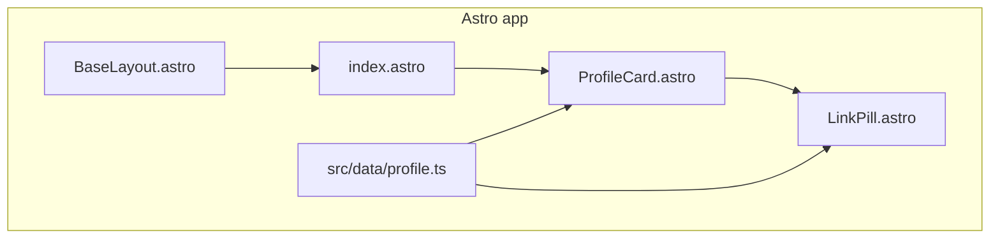

# Pixel-perfect Linktree profile clone (Astro + Tailwind)

## Objective

Deliver a **profile-card-only** clone of [linktr.ee/coachphilmataj](https://linktr.ee/coachphilmataj): hero image, top chrome (Linktree + share icons), name, bio, Instagram social, and seven link pills. **Exclude** Linktree marketing footer (“Get your own Linktree”, Report/Privacy), cookie UI, and “Explore other Linktrees” carousel.

Success is judged by **side-by-side visual comparison** at reference viewports (mobile 390×844, desktop ~1065px wide) with spacing, typography, colors, shadows, and assets aligned to extracted design tokens.

## What we already measured (source of truth)

| Token | Value |
|-------|--------|
| Page background | `#89959f` |
| Text / social icons | `#0e0d0b` |
| Heading font | IBM Plex Sans, 40px / 600 / 48px line-height |
| Body font | Link Sans Product → substitute **Inter** or **DM Sans** (proprietary on Linktree) |
| Card width (desktop) | 580px; content/links **524px** (28px horizontal inset) |
| Hero image | 580×580, top corners **24px** radius |
| Card shadow | `0 24px 32px rgba(0,0,0,0.15)` |
| Link pills | 64px tall, **16px** radius, white fill, layered shadow from inspection |
| Link gap | **14px** between pills |
| Mobile link width | **362px** (14px side margin on 390px viewport) |

**Content** (from page `__NEXT_DATA__` — no runtime scraping needed in production):

- Name: Phil Mataj  
- Bio: Elite 15 Hyrox coach / Strength & Endurance coach  
- Instagram: `https://instagram.com/coachphilmataj`  
- Links (title, url, thumbnail) — 7 entries including Work With Me → `https://form.typeform.com/to/FN4CT24R`  
- Hero + thumbnails: host under [`public/images/`](public/images/) (download from `ugc.production.linktr.ee` URLs)

## Phase 1 — Project scaffold

Workspace [`/Users/bruno/Code/sebastianherrera-site`](/Users/bruno/Code/sebastianherrera-site) is **empty** today.

1. `npm create astro@latest` — minimal template, TypeScript, no SSR unless needed (static is fine).
2. `npx astro add tailwind` — Tailwind v4 + `@import "tailwindcss"` in [`src/styles/global.css`](src/styles/global.css).
3. Extend Tailwind theme in CSS (`@theme`) with clone tokens: `background-page`, `text-primary`, font families (`IBM Plex Sans`, body sans).
4. Load **IBM Plex Sans** via `@fontsource/ibm-plex-sans` (weights 400/600) and Inter for body.
5. Arm `/goal` via `CreateGoal` on first execution turn (blocked during plan mode).

## Phase 2 — Data and assets

- [`src/data/profile.ts`](src/data/profile.ts) — typed export of name, bio, socials, links (href, label, thumbnail path, external flag).
- Script or one-time `curl` to save hero + 7 thumbnails into [`public/images/`](public/images/) with stable filenames.
- Optional: commit **reference PNGs** under [`tests/visual/reference/`](tests/visual/reference/) captured from live site (same viewports) for regression.

## Phase 3 — UI components

| File | Responsibility |
|------|----------------|
| [`src/layouts/BaseLayout.astro`](src/layouts/BaseLayout.astro) | Full-viewport `#89959f` background, font imports, centered column |
| [`src/components/ProfileCard.astro`](src/components/ProfileCard.astro) | 580px max card, hero with rounded top + gradient fade, header icon row |
| [`src/components/LinkPill.astro`](src/components/LinkPill.astro) | 64px row: 40–48px circular thumb, centered label, kebab/share icon (decorative) |
| [`src/pages/index.astro`](src/pages/index.astro) | Compose card only (no footer block) |

**Layout details to match inspection:**

- Desktop: card `max-w-[580px]`, `pt-10` top offset ~40px, `rounded-t-3xl`, shadow on card wrapper.
- Hero: `aspect-square`, `object-cover`, fade into card body (CSS gradient overlay on bottom ~30% of image).
- Typography: `h1` as measured; bio as single centered block (normalize extra whitespace from source bio string).
- Pills: `w-full max-w-[524px] mx-auto`, `rounded-2xl`, custom `box-shadow` matching 4-layer stack (Tailwind arbitrary value or small CSS class in [`src/styles/profile.css`](src/styles/profile.css)).
- Social: Instagram SVG, color `#0e0d0b`, icon size from computed ~24px.
- Header icons: simple SVG buttons (Linktree asterisk + share) — visual only unless you want share API later.

**Responsive:** Below ~640px, card is full width; link pills use `max-w-[calc(100%-28px)]` (~362px on 390).

## Phase 4 — Visual verification loop

Per your request to use **@Browser** for inspection and comparisons:

1. **Reference capture** (once): Browser navigate to live URL at 390 and 1065 widths; save screenshots to `tests/visual/reference/`.
2. **Local capture**: `npm run dev` → same viewports on `http://localhost:4321` → screenshots to `tests/visual/actual/`.
3. **Automate**: Add `@playwright/test` + `toHaveScreenshot` (or `pixelmatch` script) with modest threshold (0.1–0.2%) to allow font raster differences; iterate until green.
4. **Manual**: Side-by-side in Browser tabs during polish (hero gradient, shadow, vertical rhythm).

Document comparison steps in [`README.md`](README.md) (`npm run test:visual`).

## Phase 5 — Quality gates

- `npm run build` passes.
- Visual tests pass at **390** and **1065** widths.
- All 7 links + Instagram open correct URLs (smoke check in Playwright or manual).
- Accessibility baseline: semantic headings, alt on hero, `rel="noopener"` on external links.

## Out of scope (per your choice)

- Linktree footer, cookie banner, explore carousel, modals (About/More from Linktree).
- Share/copy native behavior (icons can be non-functional or stubbed).
- Typeform embed for “Work With Me” — link navigates to Typeform URL (same as source).

## Risk / mitigation

| Risk | Mitigation |
|------|------------|
| Link Sans Product unavailable | Inter/DM Sans + visual diff; tweak letter-spacing if needed |
| Proprietary multi-layer shadows | Copy exact `box-shadow` from CDP into CSS class |
| Hero gradient hard to match | Overlay gradient tuned against reference screenshot |
| Font rendering OS differences | Playwright uses consistent Chromium; allow small diff threshold |
